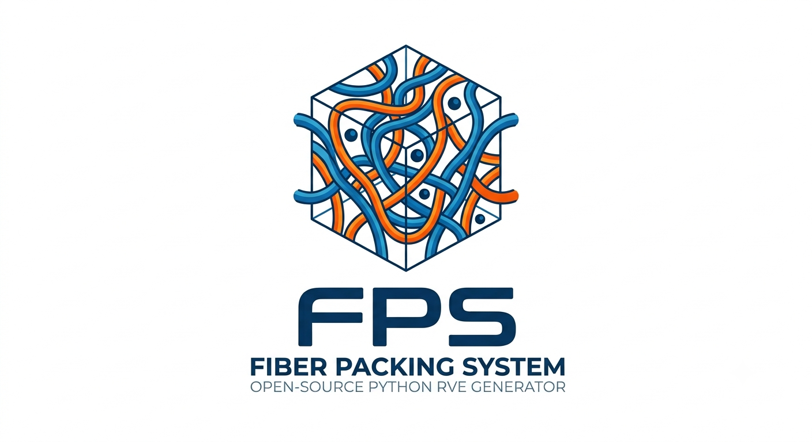

<p align="center">
  
</p>

# Fiber Packing System v6

*Langue : **Français** · [English](README.md)*

Generateur de Volumes Elementaires Representatifs (VER/RVE) pour composites a fibres renforcees. Le code genere des microstructures 3D periodiques avec fibres courbes, gere les collisions par distance segment-a-segment analytique, et exporte vers plusieurs formats pour la simulation (FEM, FFT, surrogate models).

## Architecture

Le pipeline s'execute en 5 phases sequentielles :

```
Phase 1 : Placement constructif (CSAW)      -> generation/generator.py
Phase 2 : Densification dynamique            -> generation/optimizer_dynamic.py
Phase 3 : Audit geometrique bloquant (F03)   -> validation/geometric_audit.py
Phase 4 : Generation de porosite             -> generation/porosity_gen.py
Phase 5 : Statistiques et exports            -> main.py
```

## Arborescence

```
fiber_packing_system_v6/
├── core/
│   ├── config.py              # Configuration centralisee (dataclass)
│   ├── fiber.py               # Objet Fiber (points de controle, centerline, frames)
│   ├── void.py                # Objet Void (porosite spherique)
│   └── grid_structure.py      # Grille spatiale hash pour acceleration des collisions
├── geometry/
│   ├── curves.py              # Spline Catmull-Rom centripete
│   ├── frames.py              # Repere de Bishop (transport parallele)
│   └── sections.py            # Sections droites (circulaire, superelliptique)
├── generation/
│   ├── generator.py           # Algorithme CSAW + RSDA
│   ├── periodicity.py         # Gestion des conditions periodiques (ghosts)
│   ├── optimizer_dynamic.py   # Rearrangement collectif force-biased (insertion + relaxation)
│   └── porosity_gen.py        # RSA pour pores spheriques
├── collision/
│   ├── detector.py            # API de detection de collision
│   └── detector_math.py       # Kernels Numba : distance segment-a-segment (Eberly)
├── validation/
│   ├── geometric_audit.py     # Audit final bloquant (F03) : statut, portee, {prefix}_validity.json
│   ├── audit_distance.py      # Noyau de distance de l'audit, independant du detecteur de generation
│   ├── topology.py            # Statistique historique de clearance (topology_gap_min) + distribution gaps
│   └── statistics.py          # Descripteurs spatiaux (NND, Ripley K, g(r), Voronoi)
├── visualization/
│   ├── descriptors.py         # AD-PCA (tenseurs d'orientation), MicroDescriptor
│   ├── analyzer.py            # Audit de viabilite microstructurale
│   └── plotter.py             # Visualisation 3D matplotlib
├── export/
│   ├── gmsh_exporter.py       # CAO (.step) + maillage FEM (.msh), periodique optionnel
│   ├── voxelizer.py           # Grille FFT voxelisee + export PGM
│   ├── csv_exporter.py        # Export points de controle
│   └── nastran_exporter.py    # Conversion .msh -> .bdf (Nastran)
├── utils/
│   └── logger.py              # Configuration du logging
├── main.py                    # Orchestrateur principal (5 phases)
└── cli.py                     # Interface ligne de commande (argparse)
```

## Installation

### Dependances

```bash
pip install numpy scipy numba gmsh meshio matplotlib PyQt6
```

- **numpy** : calcul vectorise
- **scipy** : cKDTree, Voronoi, fonctions speciales
- **numba** : compilation JIT des boucles critiques (collision, voxelisation)
- **gmsh** : generation de maillage elements finis
- **meshio** : conversion multi-format (requis pour `--nastran`)
- **matplotlib** : visualisation (optionnel)
- **PyQt6** : interface graphique bureau (requis pour `gui.py`)

## Utilisation

### Exemple minimal

```bash
python main.py --dims 1 1 1 --vf 0.30 --radius 0.02 --seed 42
```

### Exemple avance

```bash
python main.py \
    --dims 1 1 1 \
    --vf 0.55 \
    --radius 0.015 \
    --seed 42 \
    --bias_type planar --bias_vec1 1 0 0 --bias_vec2 0 1 0 --strength 0.8 \
    --curvature 30 \
    --rsda \
    --optimize --opt_iters 20 --injection 100 \
    --porosity --void_vf 0.01 \
    --res_fft 256 \
    --periodic_mesh \
    --nastran \
    --output RVE_UD_55
```

## Parametres CLI

### 1. Domaine et cibles

| Parametre | Type | Defaut | Description |
|-----------|------|--------|-------------|
| `--dims` | float x3 | 1.0 1.0 1.0 | Dimensions du RVE (Lx Ly Lz) |
| `--vf` | float | 0.05 | Fraction volumique cible |
| `--seed` | int | None | Graine aleatoire pour reproductibilite |

### 2. Geometrie fibre

| Parametre | Type | Defaut | Description |
|-----------|------|--------|-------------|
| `--radius` | float | 0.02 | Rayon de collision (enveloppe circulaire) |
| `--section` | str | circular | Type de section (circular, superelliptical). `main.py` refuse `superelliptical` (code de sortie 2) car l'export voxel ne prend en charge que les sections circulaires |
| `--sec_major` | float | 0.019 | Demi-axe majeur (section reelle) |
| `--sec_minor` | float | 0.015 | Demi-axe mineur (section reelle) |
| `--sec_n` | float | 2.5 | Exposant superellipse (>2 = coins arrondis) |
| `--clearance` | float | 0.0 | Clearance minimale exigee par l'audit final ; 0 autorise le contact |

### 3. Trajectoire et orientation

| Parametre | Type | Defaut | Description |
|-----------|------|--------|-------------|
| `--min_pts` | int | 15 | Min points de controle par fibre |
| `--max_pts` | int | 20 | Max points de controle par fibre |
| `--step` | float | 0.07 | Longueur de segment |
| `--max_attempts` | int | 500 | Tentatives max avant abandon |
| `--bias_type` | str | planar | Mode de biais (free, uniaxial, planar) |
| `--bias_vec1` | float x3 | 1 0 0 | Vecteur directeur principal |
| `--bias_vec2` | float x3 | 0 1 0 | Vecteur directeur secondaire (mode planar) |
| `--strength` | float | 0.0 | Force du biais (0=aleatoire, 1=strict) |
| `--curvature` | float | 60.0 | Angle de courbure max (degres) |
| `--rsda` | flag | off | Activer le rearrangement dynamique (RSDA) |
| `--rsda_perturb` | float | 0.05 | Intensite perturbation RSDA (ratio du rayon) |

### 4. Optimisation (Phase 2)

| Parametre | Type | Defaut | Description |
|-----------|------|--------|-------------|
| `--optimize` / `--no_optimize` | flag | on | Activer/desactiver le densificateur |
| `--opt_iters` | int | 10 | Tours de densification maximum |
| `--jitter` | float | 0.05 | Secousse aleatoire quand la relaxation stagne (ratio du rayon) |
| `--injection` | int | 50 | Fibres inserees au maximum par tour |
| `--dens_sweeps` | int | 400 | Balayages de relaxation maximum par tour |
| `--dens_damping` | float | 1.6 | Facteur de sur-relaxation de la resolution des contacts |

### 5. Porosite

| Parametre | Type | Defaut | Description |
|-----------|------|--------|-------------|
| `--porosity` | flag | off | Generer des pores spheriques |
| `--void_vf` | float | 0.01 | Fraction volumique cible des pores |
| `--void_mean` | float | 0.01 | Rayon moyen des pores |
| `--void_std` | float | 0.002 | Ecart-type du rayon |

### 6. Exports

| Parametre | Type | Defaut | Description |
|-----------|------|--------|-------------|
| `--output` | str | RVE_Result | Prefixe des fichiers de sortie |
| `--no_mesh` | flag | off | Desactiver l'export GMSH |
| `--res_mesh` | int | 20 | Resolution courbure maillage |
| `--res_fft` | int | 128 | Resolution grille voxels (NxNxN) |
| `--periodic_mesh` | flag | off | Maillage periodique (noeuds identiques sur faces opposees) |
| `--no_adaptive_mesh` | flag | off | Desactiver le raffinement adaptatif Distance+Threshold |
| `--nastran` | flag | off | Exporter en format Nastran .bdf |
| `--abaqus` | flag | off | Exporter le maillage en fichier d'entree Abaqus .inp |
| `--no_spatial_stats` | flag | off | Desactiver les descripteurs spatiaux |

## Fichiers de sortie

| Fichier | Description |
|---------|-------------|
| `{prefix}_validity.json` | Statut de l'audit geometrique final (`passed`, `failed`, `undetermined`), ecrit a chaque tentative |
| `{prefix}_parametric.json` | Metadonnees, parametres, statistiques, geometrie des fibres et le meme bloc `validity` |
| `{prefix}_roots.csv` | Points de controle des fibres racines |
| `{prefix}_full_periodic.csv` | Fibres racines + tous les ghosts periodiques |
| `{prefix}_voxelmap.npy` | Grille 3D uint8 (matrice=0, fibres=128, pores=255) |
| `slice****.pgm` | Coupes 2D de la grille voxelisee (format PGM P2) |
| `{prefix}.step` | Geometrie CAO (OpenCASCADE) |
| `{prefix}.msh` | Maillage elements finis (GMSH v4) |
| `{prefix}.bdf` | Maillage Nastran Bulk Data (si `--nastran`) |
| `{prefix}.inp` | Maillage Abaqus, tetraedres C3D4, ensembles `MATRIX` et `INCLUSIONS` (si `--abaqus`) |
| `{prefix}_export_check.json` | Controle des exports CAO et maillage (`passed` ou `failed`) |

Controle des exports : apres le maillage, `GmshExporter` verifie que tous les tubes
ont ete construits, que le STEP ne contient qu'un solide par volume exporte et aucune
geometrie libre (Abaqus en ferait des corps vides), que les volumes mailles de
`MATRIX` et `INCLUSIONS` remplissent exactement la boite et que, sans pores, le volume
des inclusions est a moins de 5 % du volume reel des fibres. Les volumes sont mesures
sur le maillage : `occ.getMass` est trop imprecis sur les faces balayees decoupees.
En cas d'echec, `{prefix}_export_check.json` donne la cause et `main.py` termine en
code 1. Dans Abaqus, importer le STEP en une piece par corps ; le `.inp` place
`MATRIX` et `INCLUSIONS` au niveau de l'assemblage.

Audit geometrique final (F03) : apres l'optimisation, `main.py` audite les fibres
transmises aux exports, avant porosite, statistiques et exports. Seul `passed`
autorise les exports ; `failed` et `undetermined` ecrivent `{prefix}_validity.json`
et terminent en code 1, sans toucher aux exports anterieurs du meme prefixe.
Portee de `passed` : condition suffisante de non-intersection des tubes de la
ligne echantillonnee (polyligne de 100 points voxelisee), pour le noyau d'audit
qualifie par `tests/test_audit_*.py`. Hors portee : spline continue,
auto-intersections d'une fibre, separation des fibres dans la grille voxel,
images au-dela de -1/0/+1 (refusees), sections non circulaires et pores.

## Algorithmes

### CSAW (Constructive Self-Avoiding Walk)

Placement constructif de fibres courbes par marche aleatoire biaisee avec backtracking :
1. Recherche d'un point de depart libre dans le domaine
2. Propagation segment par segment avec contrainte de courbure maximale
3. Biais d'orientation (libre, uniaxial, planaire) via melange directionnel
4. Backtracking si trop de collisions consecutives
5. Validation periodique (fibre + images ghosts) avant acceptation

### RSDA (Randomized Sequential Dynamic Adsorption)

Extension du placement standard qui perturbe les fibres deja placees pour creer de l'espace :
- Activee quand le placement standard echoue (>100 tentatives)
- Identifie les fibres en collision et les deplace legerement
- Rollback complet si la perturbation cree de nouvelles collisions
- Permet de depasser la limite de jamming du RSA pur (~54.7%)

### Detection de collision

Distance segment-a-segment analytique (algorithme d'Eberly) :
- Resolution parametrique exacte sur le carre unite [0,1] x [0,1]
- Gestion des 9 cas de clamping aux bords et des segments paralleles
- Compile en Numba JIT pour les performances
- Acceleration par grille spatiale hash (broad-phase)

### Conditions periodiques

Topologie toroidale sur les 3 axes :
- Chaque fibre traversant une face genere des images (ghosts) sur la face opposee
- Jusqu'a 26 images periodiques par fibre (6 faces + 12 aretes + 8 coins)
- Minimum Image Convention (MIC) pour les calculs de distance

### Descripteurs statistiques

Validation de la distribution spatiale (projection 2D des centroides) :
- **NND** : Distribution des distances au plus proche voisin (correction toroidale)
- **K de Ripley** : K(h) avec comparaison au processus CSR (K_poisson = pi*h^2)
- **g(r)** : Fonction de correlation de paires par comptage annulaire
- **Voronoi** : Distribution des aires, coefficient de variation (CV ~ 0 = regulier, CV ~ 0.53 = Poisson)

### Orientation (AD-PCA)

Decomposition anisotrope par analyse en composantes principales :
- Tenseur d'orientation axial A_axial (pondere par l'efficacite 1/tortuosite)
- Tenseur d'orientation planaire A_planar (pondere par la biaxialite)
- Facteurs d'Herman f_axial, f_planar dans [0, 1] (0 = isotrope, 1 = aligne)

### Voxelisation

Rasterisation 3D sur grille reguliere :
- Domaine pris en charge : sections circulaires uniquement. La rasterisation
  utilise la ligne centrale et le rayon scalaire ; toute autre section est
  refusee (`UnsupportedSectionError`) avant rasterisation, aucune grille
  circulaire n'est renvoyee pour une geometrie non circulaire
- Tags : matrice=0, fibres=128, pores=255 (uint8, choisi pour l'export PGM en niveaux de gris)
- Distance point-segment exacte par voxel (Numba JIT)
- Acceleration par BBox locale + early exit
- Export PGM (Portable Gray Map) par coupes Z

### Maillage GMSH

Generation CAO + maillage elements finis :
- Extrusion de pipe (section le long de la centerline spline)
- Fragmentation booleenne (OpenCASCADE) pour les interfaces
- Champs de taille adaptatifs (Distance + Threshold autour des interfaces)
- Maillage periodique optionnel (noeuds identiques sur faces opposees via setPeriodic)
- Algorithme 3D : HXT (parallele)

## Interface Graphique

Une interface graphique bureau (PyQt6) est disponible pour piloter le generateur sans ligne de commande.

### Lancement

```bash
python gui.py
```

### Fonctionnalites

- **Panneau de parametres** : 6 sections depliables regroupant tous les parametres CLI, avec info-bulles explicatives en francais
- **Vue 3D** : visualisation wireframe de la boite et des fibres generees (matplotlib integre)
- **Console temps reel** : affichage du log de generation au fil de l'execution
- **Barre de progression** : suivi des phases (CSAW, Optimisation, Validation, Porosite, Export)
- **Execution non bloquante** : la generation tourne en sous-processus, l'interface reste reactive
- **Arret a tout moment** : bouton pour interrompre une generation en cours

### Sections de parametres

| Section | Contenu |
|---------|---------|
| Domaine et Cibles | Dimensions du RVE, fraction volumique, graine aleatoire |
| Geometrie des Fibres | Rayon, type de section, clearance, parametres superellipse |
| Orientation | Mode de biais (libre/uniaxial/planaire), force d'alignement, courbure, RSDA |
| Densification | Activation Phase 2, tours, secousse de deblocage, injection |
| Porosite | Activation des pores, fraction volumique, rayon moyen et ecart-type |
| Export | Prefixe de sortie, resolution FFT, maillage GMSH, periodique, Nastran, stats spatiales |

## Auteur

**Devine Ngouloubi** — seul developpeur (concept, conception et implementation).
Laboratoire de Mathematiques Nicolas Oresme (LMNO, UMR 6139), Universite de
Normandie, UNICAEN, CNRS, Caen, France.

La theorie geometrique et d'homogeneisation sous-jacente a ete developpee
conjointement avec Daniel Choi et Philippe Karamian-Surville dans l'article
*Composite Structures* associe (voir Citation ci-dessous).

## Citation

Si vous utilisez FPS dans vos travaux de recherche, merci de citer l'article associe :

```bibtex
@article{Ngouloubi2026FPS,
  title   = {A geometric algorithm for dense 3D RVEs of long curved fiber composites},
  author  = {Ngouloubi, Devine and Cho{\"\i}, Daniel and Karamian-Surville, Philippe},
  journal = {Composite Structures},
  volume  = {391},
  pages   = {120524},
  year    = {2026},
  doi     = {10.1016/j.compstruct.2026.120524}
}
```

## Licence

FPS est distribue sous **GNU Affero General Public License v3.0 ou ulterieure
(AGPL-3.0-or-later)** — voir [LICENSE](LICENSE). En resume : vous etes libre
d'utiliser, etudier, modifier et partager le logiciel, mais si vous distribuez
une version modifiee **ou l'exploitez comme service reseau/SaaS**, vous devez
rendre le code source correspondant disponible sous la meme licence.

**Double licence.** L'auteur conserve l'integralite des droits d'auteur. Si les
conditions copyleft de l'AGPL ne conviennent pas a votre usage (integration
dans un produit ou service proprietaire/ferme par exemple), une **licence
commerciale** separee peut etre negociee — contact :
`exauce-devine.ngouloubi@unicaen.fr`. Voir [NOTICE](NOTICE) pour le detail.

La publication ouverte du code ne transfere **pas** la propriete ; l'archivage
ou le fork par des tiers (par exemple SoftwareX) est une copie autorisee par
la licence, pas un transfert de droits.
