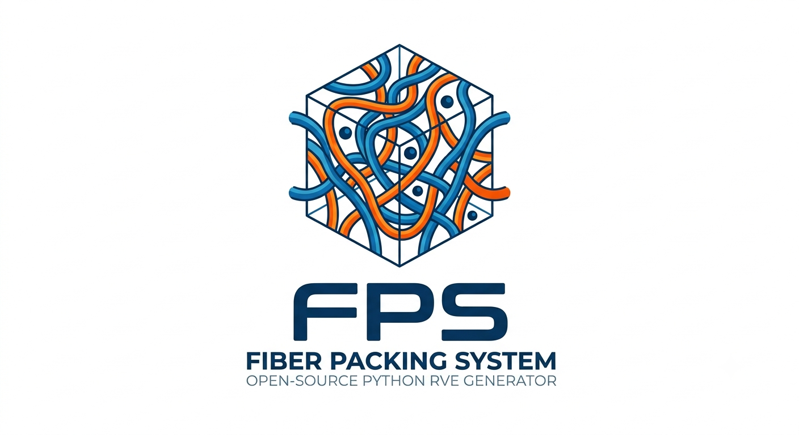

<p align="center">
  
</p>

# Fiber Packing System (FPS)

*Language: **English** · [Français](README.fr.md)*

[](LICENSE)
[](https://www.python.org/)
[](https://github.com/dev7cd/fps/actions/workflows/tests.yml)

**FPS** is an open-source Python package that generates **periodic three-phase
microstructures** — matrix, fibers and spherical pores — for computational
homogenisation, with the particularity of handling **long, curved fibers**.
Every RVE is audited (no export unless fibers and pores are disjoint, periodic
images included), reproducible from a seed, and described by a compact
parametric record from which the CAD, finite-element and voxel exports can be
regenerated.

## Highlights

- **Smooth curved fibers** — Catmull–Rom spline centrelines with a no-twist
  **Bishop frame**; circular cross-sections (a super-elliptical profile exists in
  `geometry/sections.py` but is not yet audited nor voxelised, so `main.py`
  refuses it).
- **Dense admissible packing** — a **Constructive Self-Avoiding Walk (CSAW)**
  followed by a **collective rearrangement** densification stage takes the
  volume fraction past the jamming limit of sequential placement, without
  altering fiber radii (measured times and volume fractions: [Performance](#performance)).
- **Certified output** — a **blocking geometric audit**, with its own distance
  kernel, refuses any export when two fibers (or a fiber and its periodic
  images) intersect, or when a pore overlaps a fiber or another pore.
- **Multi-phase microstructures (fibers + spherical pores)** — an optional
  porosity generator inserts **spherical voids** that overlap neither the
  fibers (periodic images included) nor one another, producing a three-phase
  RVE (matrix / fiber / pore).
- **Strict periodicity** — explicit ghost images (shifts of −1/0/+1 period per
  axis, i.e. up to 26 neighbours), applied consistently to fibers and pores.
- **Reproducible by construction** — a seed (drawn and recorded when not given)
  reproduces an RVE bit for bit, and `regenerate.py` rebuilds every export from
  the parametric record without re-running placement.
- **Fast collision detection** — spatial-hash broad phase + analytic
  segment-to-segment narrow phase (Eberly), compiled with **Numba JIT**.
- **Orientation control & descriptors** — directional/planar bias and **AD–PCA**
  orientation tensors valid for arbitrarily bent fibers.
- **Multi-format export** — parametric JSON, CAD (STEP), conformal FE mesh
  (Gmsh, optionally periodic), voxel field for FFT, Nastran `.bdf` and Abaqus
  voxel `.inp` with periodic equations.

## Architecture

The pipeline runs in 5 sequential stages:

```
Stage 1 : Constructive placement (CSAW)      -> generation/generator.py
Stage 2 : Densification (collective rearr.)   -> generation/optimizer_dynamic.py
Stage 3 : Blocking geometric audit (F03)       -> validation/geometric_audit.py
Stage 4 : Porosity (optional) + pore audit     -> generation/porosity_gen.py, validation/geometric_audit.py
Stage 5 : Statistics and export                -> main.py
```

### Directory tree

```
fps/
├── core/
│   ├── config.py              # Centralised configuration (dataclass, all parameters)
│   ├── fiber.py               # Fiber object (control points, centerline, Bishop frames)
│   ├── void.py                # Void object (spherical porosity)
│   ├── grid_structure.py      # Spatial-hash grid (broad-phase collision, reverse-mapping)
│   └── version.py             # FPS version (written into every parametric record)
├── geometry/
│   ├── curves.py              # Catmull–Rom spline + resampling
│   ├── frames.py              # Bishop frame (parallel transport, Rodrigues)
│   └── sections.py            # Cross-sections (circular, super-elliptical, factory)
├── generation/
│   ├── generator.py           # CSAW algorithm (self-avoiding walk + backtracking) + RSDA
│   ├── periodicity.py         # PeriodicManager (wrap, 26-neighbour ghosts)
│   ├── optimizer_dynamic.py   # Collective rearrangement: overlapping insertion + force-biased relaxation
│   └── porosity_gen.py        # RSA of periodic spherical pores (tested against fiber images)
├── collision/
│   ├── detector.py            # CollisionDetector (API: group_valid, segment_free, periodic)
│   └── detector_math.py       # Numba kernels: segment-to-segment distance (Eberly), MIC
├── validation/
│   ├── geometric_audit.py     # Blocking final audits (fibers F03, pores): status, scope, {prefix}_validity.json
│   ├── audit_distance.py      # Audit distance kernel, independent of the generation detector
│   ├── topology.py            # Historical clearance statistic (topology_gap_min) + gap distribution
│   └── statistics.py          # Spatial descriptors (NND, Ripley K, g(r), Voronoi)
├── visualization/
│   ├── descriptors.py         # AD–PCA (orientation tensors), MicroDescriptor
│   ├── analyzer.py            # RVE_Analyzer (viability audit)
│   └── plotter.py             # 3D wireframe visualisation + analysis reports
├── export/
│   ├── gmsh_exporter.py       # CAD (.step) + FEM (.msh), periodic + adaptive mesh
│   ├── voxelizer.py           # Voxelised FFT grid (matrix=0, fiber=128, pore=255) + PGM slices
│   ├── abaqus_exporter.py     # Abaqus voxel mesh (C3D8) with periodic equations
│   ├── csv_exporter.py        # CSV export (control points + direction)
│   └── nastran_exporter.py    # .msh -> .bdf conversion (Nastran via meshio)
├── utils/
│   └── logger.py              # Centralised logging configuration
├── benchmarks/                # Performance benchmarks and the scripts of the article figures
├── main.py                    # 5-stage orchestrator (CSAW -> Densify -> Audit -> Pores -> Export)
├── regenerate.py              # Rebuilds every export from a parametric record (no placement)
├── cli.py                     # Command-line interface (argparse, 6 parameter groups)
└── gui.py                     # PyQt6 desktop GUI (parameters, 3D view, console)
```

## Installation

Requires **Python ≥ 3.9** (the test suite runs on Python 3.9, 3.11, 3.12 and 3.13
under Linux, and 3.12 under macOS and Windows, with NumPy 1.x or 2.x).

```bash
git clone https://github.com/dev7cd/fps.git
cd fps
pip install -r requirements.txt
```

Or, as a package (from `pyproject.toml`):

```bash
pip install -e .            # core dependencies
pip install -e ".[gui,dev]" # + PyQt6 GUI and pytest
```

The package installs three commands, equivalent to the scripts of the repository:
`fps` (= `python main.py`), `fps-regenerate` (= `python regenerate.py`) and
`fps-gui` (= `python gui.py`). Numba compiles its kernels on the first run and
caches them on disk, so later runs start immediately. Run the tests with `pytest`.

| Dependency | Role |
|-----------|------|
| **numpy** | vectorised computation |
| **scipy** | cKDTree, Voronoi, special functions |
| **numba** | JIT compilation of critical loops (collision, voxelisation) |
| **gmsh** | finite-element mesh generation |
| **meshio** | multi-format conversion (required for `--nastran`) |
| **matplotlib** | visualisation (optional) |
| **PyQt6** | desktop GUI (required for `gui.py`) |

## Usage

### Minimal example

```bash
python main.py --dims 1 1 1 --vf 0.05 --radius 0.02 --seed 42
```

With the default trajectory (29–30 control points, step 0.053) the fibers are
about 1.53 long, i.e. *L/D* ≈ 38 for `--radius 0.02`; the aspect ratio is set by
`--min_pts`, `--max_pts`, `--step` and `--radius`.

### Advanced example (dense, oriented, porous RVE with full export)

```bash
python main.py \
    --dims 1 1 1 --vf 0.30 --radius 0.02 --seed 7 \
    --bias_type uniaxial --bias_vec1 1 0 0 --strength 0.3 --curvature 60 \
    --porosity --void_vf 0.02 --void_mean 0.03 --void_std 0.006 \
    --res_fft 256 --abaqus --res_abaqus 64 --periodic_mesh --nastran \
    --output RVE_UD_30
```

The CAD/mesh stage of a dense RVE can take much longer than the generation
itself; add `--no_mesh` to obtain the parametric record, CSV and voxel outputs
only, and regenerate the mesh later (see [Reproducibility](#reproducibility)).

## CLI parameters

### 1. Domain and targets

| Parameter | Type | Default | Description |
|-----------|------|--------|-------------|
| `--dims` | float x3 | 1.0 1.0 1.0 | RVE dimensions (Lx Ly Lz) |
| `--vf` | float | 0.05 | Target fiber volume fraction |
| `--seed` | int | drawn | Random seed; when omitted, one is drawn and stored in the record |

### 2. Fiber geometry

| Parameter | Type | Default | Description |
|-----------|------|--------|-------------|
| `--radius` | float | 0.02 | Collision radius (circular envelope) |
| `--section` | str | circular | Cross-section type (circular, superelliptical). `main.py` refuses `superelliptical` (exit code 1) because neither the audit nor the voxel export supports it yet |
| `--sec_major` | float | 0.019 | Reserved for super-elliptical sections (not used in v7) |
| `--sec_minor` | float | 0.015 | Reserved for super-elliptical sections (not used in v7) |
| `--sec_n` | float | 2.5 | Super-ellipse exponent (reserved, see `--section`) |
| `--clearance` | float | 0.0 | Minimum inter-fiber clearance requested by the final audit; 0 allows contact |

### 3. Trajectory and orientation

| Parameter | Type | Default | Description |
|-----------|------|--------|-------------|
| `--min_pts` | int | 29 | Min control points per fiber |
| `--max_pts` | int | 30 | Max control points per fiber |
| `--step` | float | 0.053 | Segment length |
| `--max_attempts` | int | 500 | Consecutive placement failures before Stage 1 stops |
| `--bias_type` | str | uniaxial | Bias mode (free, uniaxial, planar) |
| `--bias_vec1` | float x3 | 1 0 0 | Primary direction vector |
| `--bias_vec2` | float x3 | 0 1 0 | Secondary direction vector (planar mode) |
| `--strength` | float | 0.22 | Bias strength (0 = random, 1 = strict) |
| `--curvature` | float | 70.0 | Maximum turning angle between segments (degrees) |
| `--rsda` | flag | off | Enable dynamic rearrangement (RSDA) |
| `--rsda_perturb` | float | 0.05 | RSDA perturbation intensity (fraction of radius) |

### 4. Densification (Stage 2 — collective rearrangement)

| Parameter | Type | Default | Description |
|-----------|------|--------|-------------|
| `--optimize` / `--no_optimize` | flag | on | Enable/disable the densifier |
| `--opt_iters` | int | 10 | Max densification rounds |
| `--jitter` | float | 0.05 | Random kick used when the relaxation stalls (fraction of radius) |
| `--injection` | int | 50 | Max fibers inserted per round |
| `--dens_sweeps` | int | 400 | Max relaxation sweeps per round |
| `--dens_damping` | float | 1.6 | Over-relaxation factor of the contact resolution |

### 5. Porosity (spherical pores)

| Parameter | Type | Default | Description |
|-----------|------|--------|-------------|
| `--porosity` | flag | off | Generate spherical pores |
| `--void_vf` | float | 0.01 | Target pore volume fraction |
| `--void_mean` | float | 0.01 | Mean pore radius |
| `--void_std` | float | 0.002 | Pore radius standard deviation |

### 6. Exports

| Parameter | Type | Default | Description |
|-----------|------|--------|-------------|
| `--output` | str | RVE_Result | Output file prefix |
| `--no_mesh` | flag | off | Disable Gmsh export |
| `--res_mesh` | int | 20 | Mesh curvature resolution |
| `--res_fft` | int | 128 | Voxel grid resolution (NxNxN) |
| `--periodic_mesh` | flag | off | Periodic mesh (identical nodes on opposite faces) |
| `--no_adaptive_mesh` | flag | off | Disable Distance+Threshold adaptive refinement |
| `--nastran` | flag | off | Export to Nastran .bdf format |
| `--abaqus` | flag | off | Export the voxel grid to an Abaqus .inp input file (C3D8) |
| `--res_abaqus` | int | `--res_fft` | Voxels per axis of the Abaqus export |
| `--abaqus_no_pbc` | flag | off | Do not write the periodic equations in the Abaqus export |
| `--no_spatial_stats` | flag | off | Disable spatial descriptors |

## Output files

| File | Description |
|------|-------------|
| `{prefix}_validity.json` | status of the final geometric audits (`passed`, `failed`, `undetermined`), written for every attempt |
| `{prefix}_parametric.json` | complete CLI argument set, software versions, phase timings, statistics, fiber control points and radii, pores, and the same `validity` record — the source of truth from which `regenerate.py` rebuilds every export |
| `{prefix}_roots.csv` | control points of the root fibers |
| `{prefix}_full_periodic.csv` | root fibers + all periodic ghosts |
| `{prefix}_voxelmap.npy` | 3D uint8 grid (matrix=0, fiber=128, pore=255) |
| `{prefix}_slice****.pgm` | 2D z-slices of the voxel grid (PGM P2, grey levels 0/128/255) |
| `{prefix}.step` | CAD geometry (OpenCASCADE) |
| `{prefix}.msh` | finite-element mesh (Gmsh v4) |
| `{prefix}.bdf` | Nastran Bulk Data (with `--nastran`) |
| `{prefix}.inp` | Abaqus voxel mesh, one C3D8 per voxel (with `--abaqus`) |
| `{prefix}_export_check.json` | Check of the CAD and mesh exports (`passed` or `failed`) |

### Export check

After meshing, `GmshExporter` checks that every tube was built, that the STEP holds
one solid per exported volume and no loose geometry (Abaqus imports it as empty
bodies), that the mesh volumes of `MATRIX` and `INCLUSIONS` fill the box exactly and,
without pores, that the inclusion volume is within 5 % of the real fiber volume.
Volumes are measured on the mesh: `occ.getMass` is too inaccurate on the trimmed
swept faces. On failure, `{prefix}_export_check.json` gives the cause and `main.py`
exits with code 1. In Abaqus, import the STEP as one part per body.

### Abaqus voxel export

`--abaqus` writes one C3D8 hexahedron per voxel of the grid (the FFT grid by default, or
`--res_abaqus` voxels per axis), before the CAD export, in a few seconds. The mesh is
conforming by construction. Part `VER` holds the element sets `MATRIX`, `INCLUSIONS`,
`PORES` (when not empty), the face node sets `X0`, `X1`, `Y0`, `Y1`, `Z0`, `Z1` and the
corner node sets `C0`, `CX`, `CY`, `CZ` at (0,0,0), (Lx,0,0), (0,Ly,0), (0,0,Lz); the
assembly holds instance `VER-1`. Periodic conditions (unless `--abaqus_no_pbc`): every
node of an upper face is tied to its image by
`u(n) - u(image) - a [u(CX) - u(C0)] - b [u(CY) - u(C0)] - c [u(CZ) - u(C0)] = 0`
(a, b, c = 1 on the upper x, y, z faces), with no added node. To apply a macroscopic
strain E: fix `C0` and prescribe u(CX) = Lx E e1, u(CY) = Ly E e2, u(CZ) = Lz E e3; the
mean stress is Sigma_ia = RF_i(Ca) L_a / V. Materials, sections and steps are defined in
Abaqus. At 128 voxels per axis:
2.1 million elements, about 250 MB. The Learning Edition is limited to 1000 nodes, i.e.
`--res_abaqus 9`.

### Final geometric audit (F03)

After optimisation, `main.py` audits the fibers transmitted to the exports, before
porosity, statistics and any export; once the pores are generated, a second
blocking audit checks them (see below). Only `passed` allows the exports; `failed`
(envelope intersection or clearance below `--clearance`) and `undetermined`
(unusable input, domain not covered, audit error) write `{prefix}_validity.json`
and exit with code 1, leaving earlier exports of the same prefix untouched.

Scope of `passed`: a sufficient condition for the tubes of the sampled centerline
(the 100-point polyline rasterised by the voxelizer) to be disjoint, for the
audit kernel `validation/audit_distance.py` qualified by the tests
`tests/test_audit_*.py`. Not covered: the continuous spline, self-intersections
of a fiber with itself (zero shift), the separation of fibers in the voxel grid,
periodic images needing shifts beyond -1/0/+1 (refused) and non-circular sections.
The record carries the method, the scope, the excluded checks, the measured and
requested clearances, the responsible pair, the FPS commit and two hashes:
`fibers_sha256` (canonical `microstructure_data`) and `audited_geometry_sha256`
(geometry, box, section and interpolation convention, FPS commit).

**Pore audit.** Every pore must be disjoint from every other pore (minimum-image
centre distance) and from every fiber, periodic images of the fiber included
(exact point-to-segment distance from the pore centre to the sampled
centerline, over every shift whose fiber box can reach the pore). The result is
stored under `pores` in the validity record; a failure stops the run before any
export. The audit does not call the porosity generator's own test.

The generation detector (`collision/detector_math.py`) is unchanged; its
absolute threshold can overestimate the distance between short or nearly
parallel segments, which is why the final audit uses its own kernel.

## Algorithms

### CSAW (Constructive Self-Avoiding Walk)

Constructive placement of curved fibers by a biased self-avoiding random walk
with backtracking:

1. Search for a free starting point in the domain.
2. Grow the fiber segment-by-segment under a maximum curvature (turning angle)
   constraint.
3. Orientation bias (free, uniaxial, planar) via directional mixing.
4. Backtracking when too many consecutive collisions occur.
5. Periodic validation (fiber + ghost images) before accepting each segment.

### RSDA (Randomised Sequential Dynamic Adsorption)

An extension of the standard placement that perturbs already-placed fibers to
free up space (`--rsda`):

- Triggered when standard placement fails (>100 attempts).
- Identifies colliding fibers and displaces them slightly.
- Full rollback if the perturbation creates new collisions.

### Collective rearrangement (densification, Stage 2)

Sequential adsorption saturates well below the volume fractions a composite RVE
needs, because it can only ever reject a fiber that does not fit. Stage 2 goes
past that limit the standard way (Altendorf & Jeulin, 2011): it inserts the
missing fibers **with overlaps allowed**, then pushes every overlapping pair
apart until the configuration is admissible again — **without changing any
fiber radius**.

- Each contact displaces both fibers by half the penetration, spread over the
  control points around the contact with a Gaussian weight: the fiber bends and
  slides around its neighbour instead of translating as a rigid body.
- Displacements are accumulated and applied at once (Jacobi), so the result does
  not depend on the fiber ordering.
- After each sweep the chain is rebuilt at the generation step length, so
  densification does not silently rewrite the fiber length statistics.
- The relaxation targets a slightly larger separation than required
  (`densifier_margin`), which makes it terminate on a genuine positive gap
  instead of chasing an asymptotically small overlap.
- Everything is periodic: a fiber is measured against the closest image of its
  neighbours **and against its own images**.
- A round that cannot be relaxed is rolled back, so what Stage 2 returns is
  always free of intersections and respects `--clearance`.

### Collision detection

Analytic segment-to-segment distance (Eberly's algorithm):

- Exact parametric resolution on the unit square [0,1] × [0,1].
- Handling of the 9 edge-clamping cases and parallel segments.
- Compiled with Numba JIT for performance.
- Accelerated by a spatial-hash grid (broad phase).

### Periodic boundary conditions

Toroidal topology on the 3 axes:

- Each fiber crossing a face generates ghost images on the opposite face.
- Up to 26 periodic images per fiber (6 faces + 12 edges + 8 corners).
- Minimum Image Convention (MIC) for distance computations.

### Spherical porosity and sphere–fiber association

Optional generation of a **second inclusion phase** (spherical pores) by
Random Sequential Adsorption (`--porosity`):

- Pore radii drawn from a truncated normal law (`--void_mean`, `--void_std`),
  with adaptive radius shrinking after repeated rejections.
- **Mutual non-overlap** is enforced on both sides: pore–pore checks
  (vectorised) *and* pore–fiber checks (exact point-to-segment distance to the
  fiber centerline, against every periodic image of the fiber that can reach
  the pore), then verified by the blocking pore audit.
- Pores are periodic (their own ghost images), consistently with the fibers.
- The result is a three-phase RVE (matrix / fiber / pore) exported as voxel tags
  **0 / 128 / 255** (uint8), directly usable for FFT and FE homogenisation of
  porous fiber-reinforced composites.

### Statistical descriptors

Validation of the spatial distribution (2D projection of centroids):

- **NND**: nearest-neighbour distance distribution (toroidal correction).
- **Ripley's K**: K(h) compared to the CSR process (K_poisson = π·h²).
- **g(r)**: pair-correlation function by annular counting.
- **Voronoi**: area distribution, coefficient of variation (CV ≈ 0 = regular,
  CV ≈ 0.53 = Poisson).

### Orientation (AD–PCA)

Anisotropic decomposition via principal component analysis:

- Axial orientation tensor A_axial (weighted by efficiency 1/tortuosity).
- Planar orientation tensor A_planar (weighted by biaxiality).
- Hermans-type factors f_axial, f_planar in [0, 1] (0 = isotropic, 1 = aligned).

### Voxelisation

3D rasterisation on a regular grid:

- Supported domain: circular cross-sections only. The rasteriser uses the
  centerline and the scalar radius; any other section is refused with
  `UnsupportedSectionError` before rasterisation, so no circular grid is
  returned for a non-circular geometry.
- Tags: matrix = 0, fiber = 128, pore = 255 (uint8, chosen for direct PGM greyscale export).
- Exact point-segment distance per voxel (Numba JIT).
- Accelerated by local BBox + early exit.
- PGM (Portable Gray Map) export by z-slices, `{prefix}_slice****.pgm`.

### Gmsh meshing

CAD + finite-element mesh generation:

- Pipe extrusion (section swept along the spline centerline).
- Boolean fragmentation (OpenCASCADE) for interfaces.
- Adaptive size fields (Distance + Threshold around interfaces).
- Optional periodic mesh (identical nodes on opposite faces via `setPeriodic`).
- 3D algorithm: HXT (parallel).

## Graphical interface

A PyQt6 desktop GUI is available to drive the generator without the command line.

### Launch

```bash
python gui.py      # or: fps-gui
```

### Features

- **Parameter panel**: 6 collapsible sections grouping all CLI parameters, with
  explanatory tooltips.
- **3D view**: wireframe visualisation of the box and generated fibers
  (embedded matplotlib).
- **Real-time console**: displays the generation log as it runs.
- **Progress bar**: tracks the stages (CSAW, densification, validation,
  porosity, export).
- **Non-blocking execution**: generation runs in a subprocess; the interface
  stays responsive.
- **Stop at any time**: a button to interrupt an ongoing generation.

| Section | Content |
|---------|---------|
| Domain and Targets | RVE dimensions, volume fraction, random seed |
| Fiber Geometry | Radius, section type (circular in v7), clearance |
| Orientation | Bias mode (free/uniaxial/planar), alignment strength, curvature, RSDA |
| Densification | Enable Stage 2, rounds, stall kick, injection |
| Porosity | Enable pores, volume fraction, mean radius and standard deviation |
| Export | Output prefix, FFT resolution, Gmsh mesh, periodic, Nastran, spatial stats |

## Reproducibility

- **Seeded.** Every stochastic draw (placement, densification, pores) comes from
  generators seeded with `--seed`; without `--seed`, a seed is drawn from the
  operating system, logged and stored. Re-running the same command with the same
  seed and FPS version reproduces the RVE bit for bit (checked by
  `tests/test_reproducibility.py`).
- **Complete record.** `{prefix}_parametric.json` stores the complete CLI
  argument set (`cli_arguments`), the FPS version and commit with the Python,
  NumPy, SciPy and Numba versions (`software`), the duration of each phase
  (`timings_s`), the control points and radius of every fiber, the pores, the
  statistics and the validity record with the SHA-256 of the audited geometry.
- **Regeneration without placement.** `regenerate.py` rebuilds the
  configuration, the fibers and the pores from the record, checks that the
  rebuilt geometry has the audited SHA-256, re-runs both blocking audits and
  writes every export again. Only export options may change:

  ```bash
  python regenerate.py RVE_UD_30_parametric.json                       # same exports, prefix RVE_UD_30_regenerated
  python regenerate.py RVE_UD_30_parametric.json --res_fft 512 --no_mesh --output RVE_UD_30_512
  ```

  Options that shape the geometry (`--vf`, `--radius`, `--seed`, ...) are refused.

## Performance

Measured with FPS v7.0.0 on a laptop (Intel Core i5-1335U, Linux, Python 3.13),
each RVE generated by a single thread, unit cell, `--radius 0.02` and default
trajectory (*L/D* ≈ 38), three seeds per point:

| Target V_f | Fibers | Generation time (placement + densification + audit) |
|-----------|--------|------------------------------------------------------|
| 5 %  | 26  | ≈ 5 s |
| 10 % | 52  | ≈ 23 s |
| 20 % | 104 | ≈ 3 min |
| 25 % | 130 | ≈ 8 min |
| 30 % | 155 | ≈ 19 min |

Sequential placement alone stalls at V_f ≈ 23 %; beyond it the collective
rearrangement does the work. The voxeliser takes 11 s for a 128³ grid, 81 s for
256³ and 10 min for 512³ on the 30 % RVE (cost ≈ N^2.8).

`benchmarks/` holds the scripts that produce these numbers and the figures of the
article, and their raw results (`benchmarks/results/`, with the machine description):

```bash
python benchmarks/run_generation.py --jobs 3             # time of each phase vs target V_f, 3 seeds
python benchmarks/run_voxelizer.py benchmarks/results/rves/vf30_s1_parametric.json
python benchmarks/plot_figures.py performance --out figures/
python benchmarks/render_rve.py RVE_UD_30_parametric.json --out figures/   # 3D views before/after periodisation (needs pyvista)
```

## Documentation

- API reference (Doxygen): `docs/html/index.html` (regenerate with `doxygen Doxyfile`)
- French README: [README.fr.md](README.fr.md)

## Citing

If you use FPS in your research, please cite the software with its version (see
[CITATION.cff](CITATION.cff); GitHub's *Cite this repository* button exports it).
The constructive placement algorithm (CSAW) used in Stage 1 was first described in:

```bibtex
@article{Ngouloubi2026CSAW,
  title   = {A geometric algorithm for dense 3D RVEs of long curved fiber composites},
  author  = {Ngouloubi, Devine and Cho{\"\i}, Daniel and Karamian-Surville, Philippe},
  journal = {Composite Structures},
  volume  = {391},
  pages   = {120524},
  year    = {2026},
  doi     = {10.1016/j.compstruct.2026.120524}
}
```

## License

FPS is distributed under the **GNU Affero General Public License v3.0 or later
(AGPL-3.0-or-later)** — see [LICENSE](LICENSE). In short: you are free to use,
study, modify and share it, but if you distribute a modified version **or run it
as a network/SaaS service**, you must make your corresponding source code
available under the same license.

The full text is also provided as [Licence.txt](Licence.txt). Third-party
dependencies keep their own licenses, see [NOTICE](NOTICE).

## Author

**Devine Ngouloubi** — sole developer (concept, design and implementation).
Nicolas Oresme Mathematics Laboratory (LMNO, UMR 6139), Normandy University,
UNICAEN, CNRS, Caen, France.

The author thanks Daniel Choï and Philippe Karamian-Surville for discussions on
the geometric framework.
